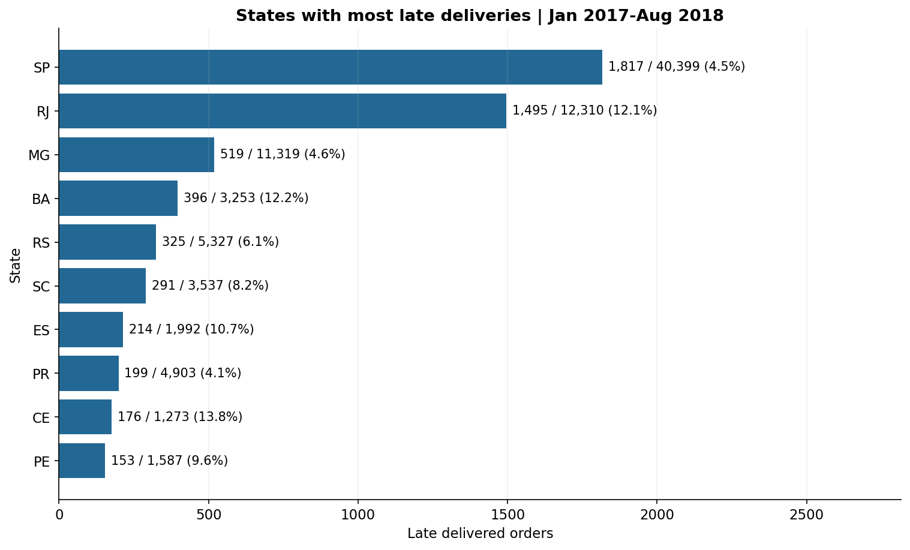
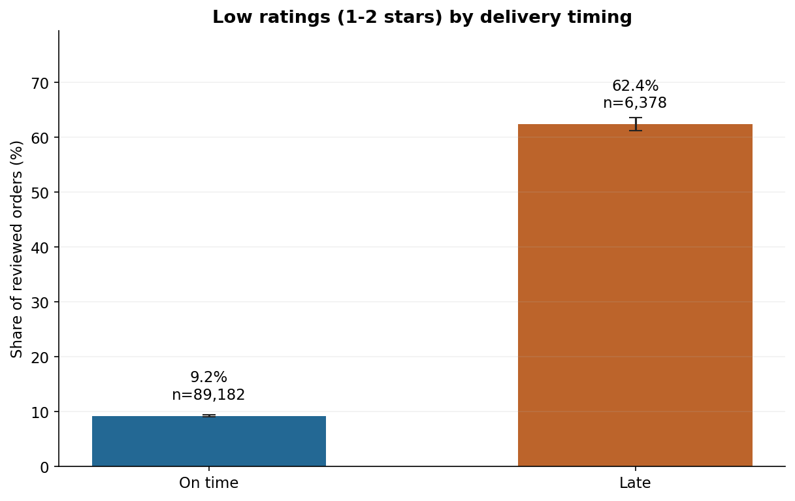

# Olist: доставка и клиентский опыт

Портфолио аналитика данных · Python / pandas · SQL / SQLite · Jupyter

Исследование исторических заказов бразильского маркетплейса Olist. Цель — определить регионы для проверки процессов доставки и оценить связь нарушения обещанного срока с отзывами покупателей.

## Результат

За январь 2017 — август 2018 года рассмотрено 99 092 заказа. Для оценки сроков пригодны 96 203 доставленных заказа; 6 531 (6,79%) доставлены позже обещанной календарной даты. Медиана доставки — 10,21 дня, 90-й процентиль — 23,06 дня.

Среди заказов с отзывом доля оценок 1–2 составляет 9,25% при своевременной доставке и 62,42% при задержке. Это связь, а не оценка причинного эффекта: при ограничении отзывами после получения разница снижается с 53,17 до 10,22 процентного пункта.

## Просмотр результатов

[Аналитический отчёт](reports/analysis_report.md) · [Выполненный ноутбук](notebooks/01_olist_delivery_analysis.ipynb)





## Запуск в Windows

1. Распаковать архив в папку проекта. Подготовить данные по [инструкции](data/raw/README.md). При использовании существующей папки `D:\Projects\olist_analytics` сохранить её `.venv_313`.
2. Запустить `start_olist.bat`. Он использует Python 3.13, открывает JupyterLab, CMD с окружением и отдельную CMD с запросом прав администратора.
3. Открыть `notebooks/01_olist_delivery_analysis.ipynb`, выбрать `Python (Olist 3.13)` и выполнить Run → Run All Cells.

Для пересчёта без ноутбука в CMD с активированным окружением:

```bat
python -m pip install -r requirements.txt
python run_analysis.py
```

На другой системе: создать виртуальное окружение, установить `requirements.txt`, выполнить `python run_analysis.py`. Пути в Python определяются относительно проекта. BAT предназначен для Windows; анализ проверен в Linux, версии записаны в `reports/validation.json`. Windows BAT ранее проверен пользователем; полный новый анализ на его компьютере ещё не проверен.

## Состав

- `notebooks/01_olist_delivery_analysis.ipynb` — выполненный анализ с таблицами и графиками.
- `src/analysis.py` — подготовка данных, метрики, контроль качества и экспорт.
- `sql/` — пять выполненных SQL-запросов, включая предварительную агрегацию и оконные функции.
- `reports/analysis_report.md` — выводы и рекомендации.
- `reports/figures/`, `reports/tables/` — графики и расчёты.
- `reports/analysis_notebook.html` — просмотр анализа без Jupyter.
- `docs/` — методология, описание витрины, использование ИИ, инструкция Power BI.
- `data/raw/` — инструкция получения исходных CSV; датасет скачивается отдельно и исключён из Git.
- `data/processed/orders_mart.csv` — витрина с одной строкой на заказ, создаётся при запуске. Она и SQLite не включены в GitHub-архив.

## Данные и воспроизводимость

Источник: [Brazilian E-Commerce Public Dataset by Olist](https://www.kaggle.com/datasets/olistbr/brazilian-ecommerce). Контрольные суммы CSV — `reports/source_manifest.csv`. Таблица геолокации присутствует в исходном наборе, но не используется: анализ проводится на уровне штата покупателя.

Проверяются ключи, внешние связи, сохранение количества заказов и денежных сумм, согласованность результатов SQL и pandas. Все пять SQL-запросов выполнены на SQLite; PostgreSQL не проверялся. Зависимости заданы диапазонами, а фактически проверенные версии зафиксированы в отчёте проверки. При изменении версий повторно выполните анализ.

## Использование ИИ

Проект разработан с помощью ChatGPT: подготовка и проверка кода, методология, интерпретация и документация. Подробности — [AI_USAGE.md](docs/AI_USAGE.md). Проект не заявляется как выполненный без ИИ.

Данные распространяются по CC BY-NC-SA 4.0; условия и атрибуция — [DATA_LICENSE.md](docs/DATA_LICENSE.md).
